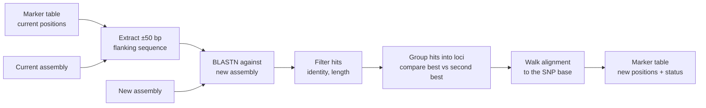

# SNPfix

**Transfer SNP array marker positions to a new genome assembly, with paralog-aware confidence labels.**

SNPfix moves the coordinates of SNP array markers (for example Illumina iSelect or Affymetrix Axiom) from one genome assembly to another. Instead of lifting coordinates over a whole-genome alignment, it takes each marker's flanking sequence from the current assembly, finds it in the new assembly with BLAST and calculates the exact SNP position from the alignment. Markers with similar copies elsewhere in the genome, such as paralogs or homeologs, are flagged rather than silently placed.

It was developed for large, repetitive cereal genomes (barley, wheat), but works with any pair of assemblies.

## SNPfix pros

- **No whole-genome alignment.** Only short marker sequences are aligned, so SNPfix needs a fraction of the CPU time and memory of chain-based liftover tools. On 3 × 20 Mb test assemblies it used about 30 times less CPU time and 40–65 times less memory, and its cost barely changes with genome size.
- **Independent of collinearity.** Markers are found wherever their sequence is: in inverted or translocated segments, or on unplaced scaffolds.
- **Base-exact positions.** The SNP coordinate is obtained by walking the alignment, so indels and reverse-strand hits are handled exactly.
- **Paralogy is reported, not hidden.** Each marker is labelled `Unique`, `Unique_paralog` or `Multi-mapped`, and for paralog-flagged markers the competing locus is reported. This matters for genetics: a marker with a similar copy may be misplaced, and its probe may hybridise to both copies.
- **Every marker is accounted for.** Markers that cannot be placed stay in the output with a status that explains why.

On the barley 50K iSelect array (Morex V2 → V3), SNPfix reproduced the official V3 position of 99.83% of assessable markers at base-pair resolution, with a precision of 99.997% for single-position placements.

## How it works



1. **Flank extraction.** For each marker, 50 bp on each side of the SNP are taken from the current assembly (101 bp query).
2. **Alignment.** Queries are aligned to the new assembly with `blastn` (megablast).
3. **Filtering.** Alignments need at least 90% identity and an alignment length of at least 80% of 2 × flank size.
4. **Locus classification.** Hits on the same sequence within 1 kb form one locus. The ratio R of the second-best to the best locus bitscore decides the label:

   | R | Status | Reported position |
   |---|---|---|
   | < 0.90 | `Unique` | best locus |
   | 0.90–0.98 | `Unique_paralog` | best locus, plus the competing locus in `alt_locus` |
   | ≥ 0.98 | `Multi-mapped` | all loci that cannot be distinguished |

5. **Position projection.** The SNP coordinate is found by walking along the aligned query and subject sequences, taking indels and strand into account.

## Installation

Requirements: [Nextflow](https://www.nextflow.io/), Python ≥ 3.8 with `pandas` and `pyfaidx`, `samtools` and BLAST+.

The easiest way is a conda environment:

```bash
conda create -n snpfix -c conda-forge -c bioconda nextflow blast samtools python pandas pyfaidx
conda activate snpfix
git clone https://github.com/<user>/SNPfix.git
cd SNPfix
```

## Input

| Input | Description |
|---|---|
| Marker table | Tab-separated, with a header line and three columns: marker name, chromosome, position (1-based) on the current assembly |
| Current assembly | FASTA of the assembly the marker positions refer to |
| New assembly | FASTA of the assembly to transfer positions to |

Example marker table:

```
Name	Chr	Position
JHI-Hv50k-2016-127	1H	49952
JHI-Hv50k-2016-121	1H	50328
```

> **Chromosome names must match the FASTA headers of the current assembly** (the first word of each header). If the FASTA uses accessions such as `LR812970.1` while the marker table uses `1H`, rename one of them first. Markers on sequences that are not in the FASTA are reported as `Chr_Not_In_Reference`.

## Usage

```bash
nextflow run main.nf \
    --markers     markers_v2.tsv \
    --ref_current MorexV2.fasta \
    --ref_new     MorexV3.fasta \
    --v_current   v2 \
    --v_new       v3 \
    --scripts     $PWD/scripts \
    --outdir      results
```

Default values can also be set in `nextflow.config`.

### Parameters

| Parameter | Default | Description |
|---|---|---|
| `--markers` | – | Marker table with positions on the current assembly |
| `--ref_current` | – | Current assembly (FASTA) |
| `--ref_new` | – | New assembly (FASTA) |
| `--v_current`, `--v_new` | – | Labels used in output file names |
| `--scripts` | – | Folder with the Python scripts |
| `--outdir` | – | Output folder |
| `--reference` | – | Folder for the index of the current assembly |
| `--flank_size` | 50 | Bases on each side of the SNP (query length 2 × flank + 1) |
| `--paralog_ratio` | 0.90 | R at or above this → `Unique_paralog` |
| `--multi_ratio` | 0.98 | R at or above this → `Multi-mapped` |
| `--merge_dist` | 1000 | Hits closer than this (bp) on one sequence form one locus |
| `--blast_dust` | yes | `no` disables BLAST low-complexity masking of queries |

The identity (90%) and coverage (80%) thresholds are set in `scripts/blast_res_filter.py` (arguments 5 and 6).

### Choosing thresholds

- **Assembly update of the same genotype:** little divergence is expected, so the defaults, or a stricter identity threshold, are appropriate.
- **Different cultivars or species:** higher divergence. More markers will be left unplaced, and paralog flags become more important to inspect.
- **Low-complexity markers** (poly-T, GA repeats) may get no hit with DUST masking on; `--blast_dust no` recovers some of them at the cost of more repetitive hits.

## Output

`<outdir>/chip_<v_new>.txt` contains one row per marker, or one row per locus for `Multi-mapped` markers:

```
Name	Chr	Position	Status	second_best_ratio	alt_locus
JHI-Hv50k-2016-127	NC_058518.1	49952	Unique	0.0
JHI-Hv50k-2016-452996	NC_058523.1	58370889	Unique_paralog	0.94	NC_058524.1:24141871
JHI-Hv50k-2016-5408	n.a.		No_Position
```

| Column | Meaning |
|---|---|
| `Status` | See below |
| `second_best_ratio` | R: bitscore of the second-best locus divided by the best (0 = no competing locus). A continuous measure of placement confidence |
| `alt_locus` | For `Unique_paralog`: SNP position at the competing locus |

### Status values

| Status | Meaning |
|---|---|
| `Unique` | One locus, or competitors clearly weaker (R < 0.90) |
| `Unique_paralog` | Best locus reported; a similar copy exists (0.90 ≤ R < 0.98), see `alt_locus` |
| `Multi-mapped` | Loci cannot be distinguished by sequence (R ≥ 0.98); all are reported |
| `No_Position` | No position in the input marker table |
| `Chr_Not_In_Reference` | Chromosome or contig not found in the current assembly |
| `Failed_BLAST` | No alignment to the new assembly |
| `Failed_Filter` | Alignments found, none passing identity and length thresholds |
| `Marker_outside_alignment` | SNP base outside the aligned part of the flank |
| `Marker_in_gap` | SNP base aligned to a gap in the new assembly |


## Benchmark

The `benchmark/` folder contains the code used to evaluate SNPfix against CrossMap, rustybam and pyliftover on simulated assemblies derived from wheat chromosomes 1A, 1B and 1D:

- `simulate_benchmark.py` builds a new assembly with known marker positions under two scenarios: an assembly update (divergence, gaps, unplaced scaffolds) and disrupted synteny (inversions, translocations, transpositions, deletions).
- `evaluate_liftover.py` scores each tool against the true positions.
- `aggregate_seeds_v2.py` summarises results over replicates.

Main findings:
- In an assembly update, SNPfix was as accurate as CrossMap (99.2%), and it placed markers on unplaced scaffolds correctly where CrossMap placed none.
- Inside small inversions and translocated segments, SNPfix placed more markers correctly (92–96% versus 53–91%).
- With higher divergence, SNPfix left more markers unplaced (about 4%).

## Known limitations

- **Markers whose locus is missing from the new assembly** (deletions, presence/absence variation) can be placed on a similar homeologous copy, which is then reported as `Unique` because no competitor remains.
- **Long indels in the flank** lower BLAST identity below the 90% threshold, so more markers are left unplaced when the assemblies differ more.
- **A position on the current assembly is required.** Markers known only by their probe sequence cannot be processed yet.

## Repository layout

```
main.nf                 Nextflow workflow
nextflow.config         default parameters
scripts/
  flank_seq.py          flank extraction
  blast_res_filter.py   identity / length filter
  select_position.py    locus grouping and Unique / Unique_paralog / Multi-mapped
  find_position.py      SNP position from the alignment
  concatinate.py        final marker table
benchmark/              simulation and evaluation code
assets/			small test data
```

